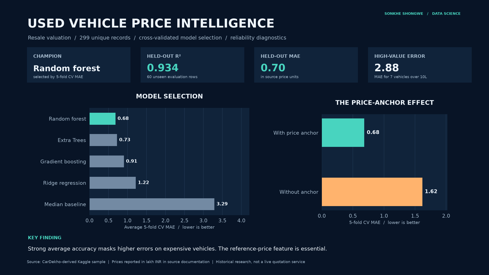
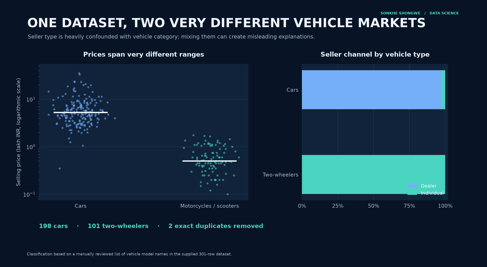
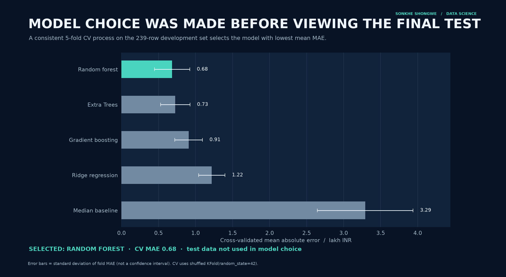
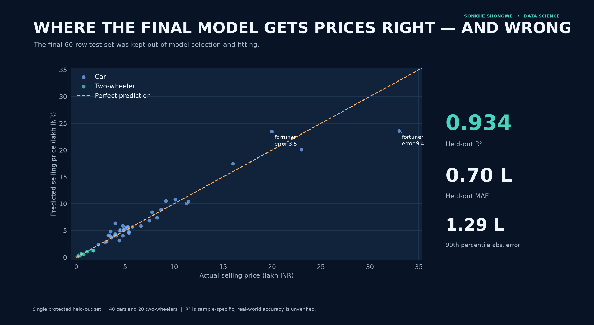
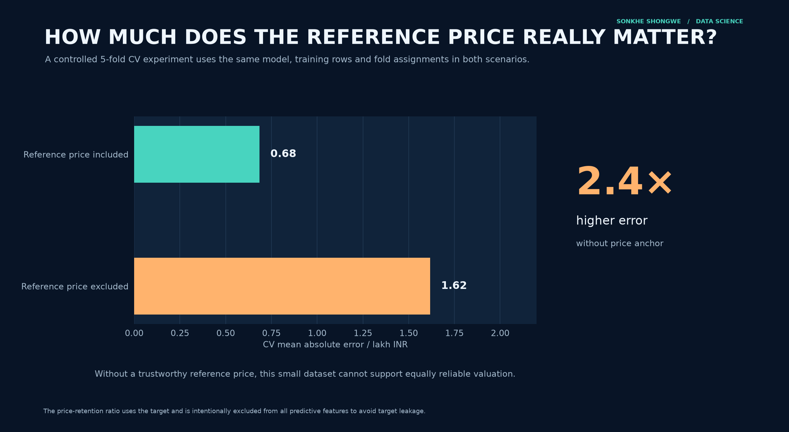
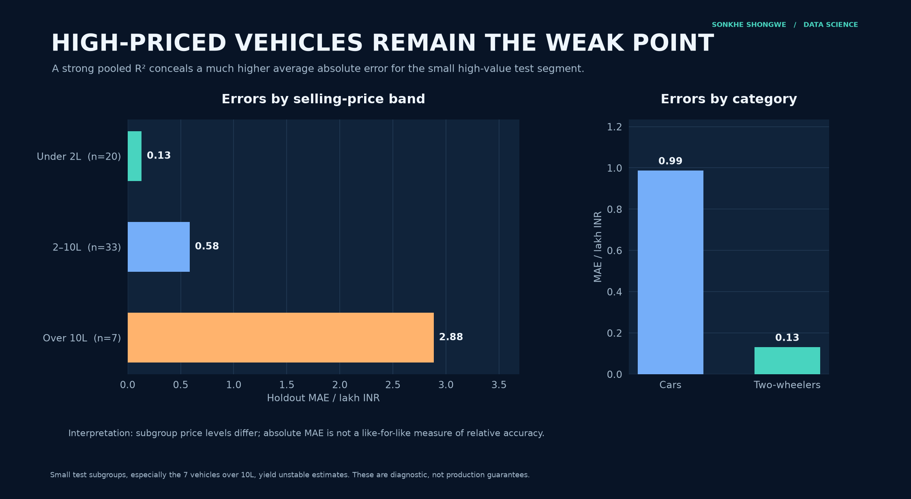
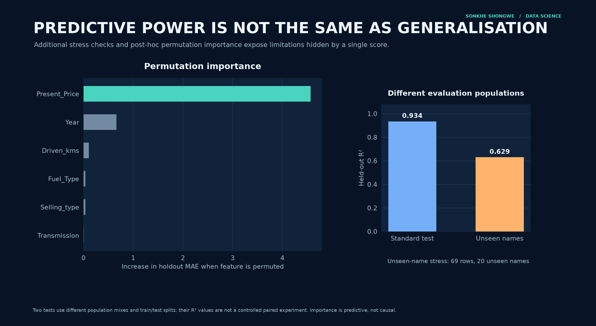

# Used Vehicle Price Intelligence

### Predicting resale value, investigating price signals, and stress-testing model reliability

> **Main conclusion:** A Random Forest selected by five-fold development-set cross-validation achieves **R² 0.934** and **MAE 0.70 lakh INR** on a protected 60-row evaluation set. Performance depends heavily on knowing a reference price, and is much less reliable for the highest-priced vehicles. This is a historical dataset study, **not** an operational valuation product.



**[Open the full executed notebook](car_price_prediction.ipynb)** · [Methodology](reports/METHODOLOGY.md) · [Model card](reports/MODEL_CARD.md) · [All visualisations](assets/)

## Business question

**How accurately can a used vehicle's selling price be estimated, how much does a known reference price contribute, and where is the model unreliable?**

This is a small-sample case study in **predictive modelling, rigorous evaluation and honest interpretation**. It is not a system for providing live market quotes.

## What the data really contains

The provided CSV contains **301 observations** and nine original fields. It includes **cars and motorcycles/scooters**, despite the source's “car” naming. Two exact duplicate records are removed, leaving **299 records: 198 cars and 101 two-wheelers**. The **Land Cruiser with reference price 92.6 lakh** is **retained**, not quietly discarded.

Vehicle category is assigned by a **transparent, reviewed list of model names already in the CSV**, rather than guessing from seller type or price. This mapping is recorded in [`src/catalog.py`](src/catalog.py).

- **Source of dataset copy:** [Kaggle: Vehicle dataset from CarDekho](https://www.kaggle.com/datasets/nehalbirla/vehicle-dataset-from-cardekho), file commonly called `car data.csv` (this repository's CSV uses slightly different column spellings).
- **Price units:** lakh Indian rupees (₹100,000), as described in third-party documentation for the same CarDekho sample; the raw CSV has **no unit metadata**.
- **Interpretation:** `Present_Price` is described in dataset documentation as a current showroom/reference price. Neither exact sale dates nor confirmation of completed transaction prices are included. No claim of live market validity is made.
- **Reporting restrictions:** only the 301-row supplied dataset is analysed. No external observations or synthetic rows are merged into modelling data.



## Research design and results

The modelling dataset is split **after exact deduplication** into a stratified **239-row development set** and a **60-row protected test set**, with the latter used only after selecting the champion by five-fold shuffled CV MAE. All learned preprocessing takes place inside scikit-learn pipelines.

| Candidate model | Mean development CV MAE (lakh INR) | CV RMSE | Mean CV R² |
|:--|--:|--:|--:|
| Random forest | 0.684 | 1.594 | 0.881 |
| Extra Trees | 0.727 | 1.609 | 0.877 |
| Gradient boosting | 0.907 | 1.794 | 0.850 |
| Ridge regression | 1.219 | 1.775 | 0.839 |
| Median baseline | 3.291 | 4.734 | -0.085 |




The winner is **Random forest**, chosen **before inspecting final test predictions**.

| Final protected test metric | Value |
|:--|--:|
| Test records | 60 |
| R² | 0.934 |
| MAE | 0.702 lakh INR |
| RMSE | 1.495 lakh INR |
| Median absolute error | 0.346 lakh INR |
| 90th percentile absolute error | 1.293 lakh INR |



### Experiment 1: How dependent are predictions on a reference price?

For the **same selected algorithm**, development rows and CV folds:

| Controlled experiment | Development CV MAE | Development CV R² |
|:--|--:|--:|
| Reference price included | 0.684 | 0.881 |
| Reference price excluded | 1.617 | 0.592 |

Without `Present_Price`, the CV MAE is **2.4 times larger**. A price prediction in a situation where this reference value is unavailable is a materially harder task.



### Experiment 2: Does average accuracy hide expensive-vehicle errors?

The protected test set has **7 observations above 10 lakh INR**. Its mean absolute error is **2.88 lakh**, compared with **0.13 lakh** for the 20 observations below 2 lakh. These are different price ranges and relative-error levels may tell a different story; the high-value subgroup is also too small for a stable production guarantee.



### Experiment 3: What happens for unfamiliar model names?

A **separate model-name-disjoint split** trains the same selected algorithm on a different group of rows and evaluates it on **69 rows with 20 unseen model names**. Its R² is **0.629**. Because both the training sample and test distribution change, this is an *illustrative generalisation stress test*, **not a paired estimate of performance deterioration** from the original 60-row holdout. The model name itself is excluded from the predictor matrix.



### What the model actually learns

Permutation importance on held-out predictions makes `Present_Price` the dominant information source, followed by vehicle year. This is **predictive dependence, not causality**. The seller category is heavily mixed up with vehicle type: **100%** of two-wheeler observations here are individual sellers; among cars, only around **2.5%** are individual sellers.

A ratio such as `Selling_Price / Present_Price` may be informative for descriptive comparison but **contains the target** and is never used as an input feature. Similarly, a vehicle age cannot be calculated precisely without a known reference or valuation year.

## How to reproduce

1. Use Python 3.11+; create an isolated environment.
2. Install packages: `python -m pip install -r requirements.txt`.
3. From this folder run `python run_analysis.py` to recalculate every result and all eight PNG figures.
4. Run `python -m pytest -q` for the automated checks.
5. Open `car_price_prediction.ipynb` in Jupyter and **Restart & Run All**.

The notebook displays both direct analytical tables and the generated figures. Numeric reports are saved to `reports/`. Source CSV is left unchanged.

```text
car-price-prediction/
├── README.md
├── car_data.csv
├── car_price_prediction.ipynb
├── run_analysis.py
├── requirements.txt
├── src/
│   ├── analysis.py
│   ├── visuals.py
│   └── catalog.py
├── assets/
│   └── 00–07: eight publication-ready PNGs
├── reports/
│   ├── METHODOLOGY.md
│   ├── MODEL_CARD.md
│   ├── metrics.json
│   └── reproducible CSV reports
└── tests/
    └── test_reconstruction.py
```

## Responsible interpretation

- **Small historical sample:** no claim of current-2026 applicability, representative market performance or production readiness.
- **Data composition:** the mix of cars and motorcycles strongly confounds the selling channel; subgroup analyses are descriptive.
- **Price anchor:** a correct reference price may not always be available at prediction time; the ablation experiment quantifies that vulnerability.
- **No verified time stamps:** vehicle manufacture year is not the precise vehicle age; no temporal holdout is claimed.
- **Subgroup variance:** 7 high-value test vehicles are too few for confident claims about expensive-vehicle pricing.
- **Generalisation:** the separate unfamiliar-model exercise uses a different population mix and must not be interpreted as a controlled before/after comparison.
- **Data copyright/attribution:** this is a credited analytical adaptation of the Kaggle-hosted dataset. The Kaggle dataset page remains the reference for its licensing and original publisher terms.

**Original project preserved in Git history.** The replacement was developed and audited locally; no publication is implied by this README.
