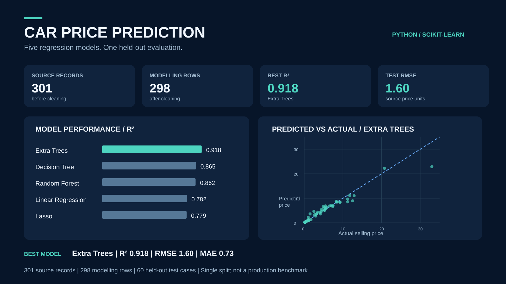

# Car Price Prediction with Machine Learning

A Python project that explores the factors associated with used-car selling prices and compares five regression models for price prediction.

**Tools:** Python, Pandas, NumPy, SciPy, Matplotlib, Seaborn, Scikit-learn  
**Techniques:** Data cleaning, exploratory analysis, feature encoding, regression and model evaluation

### Portfolio visuals

- [Project overview (SVG)](./assets/car_price_portfolio_overview.svg), with held-out model scores and an actual-versus-predicted scatter plot.
- [Model comparison (SVG)](./assets/car_price_model_comparison.svg), comparing test-set RMSE for all five models.
- Run `python build_portfolio_media.py` from this folder to regenerate editable-quality PNG images and a CSV of model scores. Install `pandas numpy matplotlib scikit-learn` first.
- The new reproduction script fixes the previously unseeded Decision Tree (`random_state=42`), so **that single model's score differs from the original notebook run** (new R² ~0.865 versus earlier ~0.847). The best Extra Trees model remains R² ~0.918, RMSE ~1.60 and MAE ~0.73.

The figures describe one held-out split of a small dataset, not deployment performance. Price units are those in the source file, not a verified currency.

Original exploratory visualisation

## Project objective

Used-car prices vary with age, mileage, condition-related indicators and selling arrangements. This project investigates the relationships in a vehicle dataset and tests how accurately different regression methods can estimate selling prices.

## Dataset

The included [car_data.csv](./car_data.csv) contains **301 vehicle records** and **9 columns**.

| Field | Purpose |
| --- | --- |
| `Selling_Price` | Target variable: recorded vehicle selling price |
| `Present_Price` | Vehicle's listed current price |
| `Year` | Vehicle year |
| `Driven_kms` | Recorded mileage |
| `Fuel_Type` | Petrol, diesel or CNG |
| `Selling_type` | Dealer or individual |
| `Transmission` | Manual or automatic |
| `Owner` | Previous-owner count |
| `Car_Name` | Vehicle name, excluded from model features |

The notebook identifies **two duplicate records** and removes **one high-`Present_Price` observation**, leaving **298 rows for modelling**.

## Approach

1. **Data quality:** Check missing values and duplicates, remove duplicate rows and inspect feature distributions.
2. **Preparation:** Encode categorical variables and examine a high-price observation before excluding it.
3. **Exploratory analysis:** Compare selling prices across vehicle years, fuel types and seller types; examine correlations with mileage and present price.
4. **Modelling:** Use an 80/20 train/test split (`random_state=42`) and fit five regression models.
5. **Evaluation:** Compare model performance using mean absolute error (MAE), root mean squared error (RMSE) and R²; inspect feature importance and prediction residuals.

## Model comparison

The following values are from the notebook's held-out test set (**60 records**):

| Model | R² | RMSE | MAE |
| --- | ---: | ---: | ---: |
| **Extra Trees** | **0.918** | **1.60** | **0.73** |
| Random Forest | 0.862 | 2.08 | 0.96 |
| Decision Tree | 0.847 | 2.19 | 1.23 |
| Linear Regression | 0.782 | 2.61 | 1.63 |
| Lasso Regression | 0.779 | 2.63 | 1.67 |

**Extra Trees Regression** performed best on this test split, explaining approximately **92% of the variation in selling prices** in the test data.

## Key observations

- **Present price** showed a strong positive relationship with selling price in the exploratory analysis.
- The Extra Trees model ranked **present price** as its most important input, followed by seller type.
- Prediction errors were generally smaller for lower-priced vehicles; the residual analysis identified larger errors for some observations.

These findings describe patterns in this dataset. Feature importance does not establish that a variable causes a price change.

## Explore the notebook

The complete data preparation, charts, modelling and evaluation are in [car_price_prediction.ipynb](./car_price_prediction.ipynb).

To run the analysis locally:

1. Install Python and Jupyter Notebook.
2. Install packages: `pip install numpy pandas scipy matplotlib seaborn scikit-learn notebook`
3. Keep `car_price_prediction.ipynb` and `car_data.csv` in the same directory.
4. Open the notebook with Jupyter and run its cells in order.

## Limitations

The dataset is small, and the model comparison relies primarily on one train/test split. Results may vary on new datasets and should not be treated as evidence of production readiness. The notebook also labels a cross-validation **mean squared error** output as "RMSE"; that label should be corrected in the notebook before interpreting its cross-validation results.
