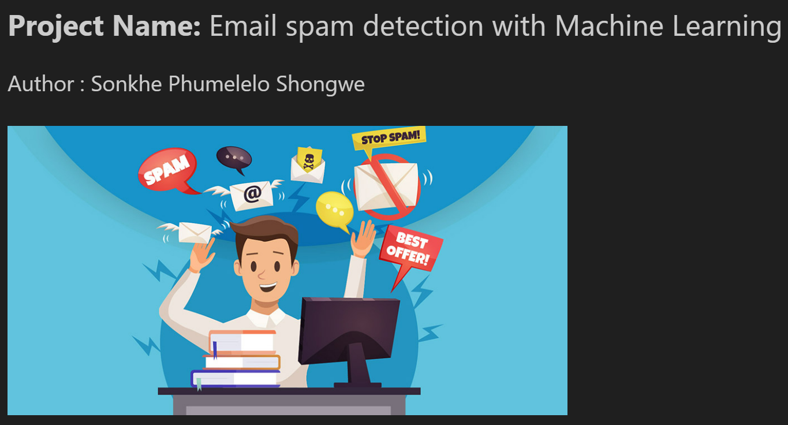

# SMS Spam Detection with Machine Learning

A text-classification project comparing machine-learning models for identifying spam and legitimate SMS messages.

**Tools:** Python, Pandas, NLTK, Scikit-learn, imbalanced-learn, Matplotlib, Seaborn  
**Techniques:** Data cleaning, natural language processing (NLP), TF-IDF, class balancing, classification and model evaluation

## Project objective

Classify short text messages as **spam** or **ham** (legitimate messages) while balancing two competing errors: missing spam and incorrectly flagging legitimate messages.

Although the original project folder refers to *email* spam, the included dataset contains **SMS messages**, not emails. The reported results therefore describe SMS classification and have not been validated on an email dataset.

## Dataset

The included [sms_sms_spam.csv](./sms_sms_spam.csv) contains **5,572 labelled messages**. Each message has a label (`spam` or `ham`) and text content.

| Data preparation | Records |
| --- | ---: |
| Original messages | 5,572 |
| Duplicate rows identified and removed | 403 |
| Messages remaining | **5,169** |
| Legitimate messages (ham) | 4,516 |
| Spam messages | 653 |

The original CSV includes three mostly empty additional columns, which the notebook removes before analysis. The class distribution is imbalanced, with many more legitimate messages than spam messages.

## Method

1. **Prepare the data:** Load the CSV, retain text and class labels, check missing values, and remove duplicate records.
2. **Explore the messages:** Examine class proportions, message lengths and frequent words.
3. **Process text:** Clean message content, tokenise words, remove stopwords and apply lemmatisation.
4. **Build classification pipelines:** Encode text using TF-IDF and apply SMOTE to the training data within the model pipelines to address class imbalance.
5. **Train and compare models:** Use an 80/20 train/test split (`random_state=42`) to evaluate Logistic Regression, Random Forest, Extra Trees and Support Vector Machine (SVM).
6. **Evaluate trade-offs:** Compare held-out accuracy and the precision, recall and F1-score for the spam class, alongside confusion matrices and precision-recall/ROC curves.

## Model results

The following results are reported in the saved notebook for its **1,034-message test set**:

| Model | Accuracy | Spam precision | Spam recall | Spam F1 |
| --- | ---: | ---: | ---: | ---: |
| **Extra Trees** | **97.78%** | 0.96 | 0.88 | **0.92** |
| Random Forest | 97.20% | 0.99 | 0.81 | 0.89 |
| Logistic Regression | 96.52% | 0.84 | **0.93** | 0.88 |
| SVM | 96.32% | 0.88 | 0.86 | 0.87 |

**Extra Trees** achieved the highest test accuracy and spam F1-score in this comparison.

However, **Logistic Regression had higher spam recall** (0.93 versus 0.88), while Random Forest had the highest spam precision (0.99). The best choice depends on whether the application prioritises catching more spam or avoiding false alarms.

## What the analysis demonstrates

- Handling an imbalanced text dataset and preparing it for supervised classification.
- Building repeatable TF-IDF and model pipelines with training-time resampling.
- Comparing several models using more than accuracy alone.
- Interpreting the precision–recall trade-off for practical spam filtering decisions.

## Explore the notebook

The full analysis, visualisations and classification experiments are in [sms_spam_detection.ipynb](./sms_spam_detection.ipynb).

To run it locally:

1. Install Python and Jupyter Notebook.
2. Install the main dependencies: `pip install numpy pandas matplotlib seaborn scikit-learn imbalanced-learn nltk wordcloud notebook`.
3. Keep `sms_sms_spam.csv` and the notebook in the same directory.
4. Open the notebook in Jupyter and run its cells in order. The notebook downloads its required NLTK language resources.

## Limitations

The project is a notebook experiment, **not a deployed spam-filtering service**. Its scores come from one held-out test split on an SMS dataset. Performance on new kinds of messages, including emails, would require separate evaluation. Some older narrative text and metric labels in the notebook also need cleanup to match the calculations and class-specific results.
