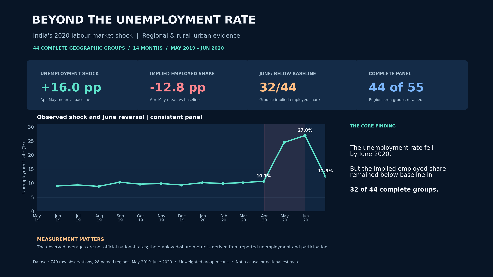
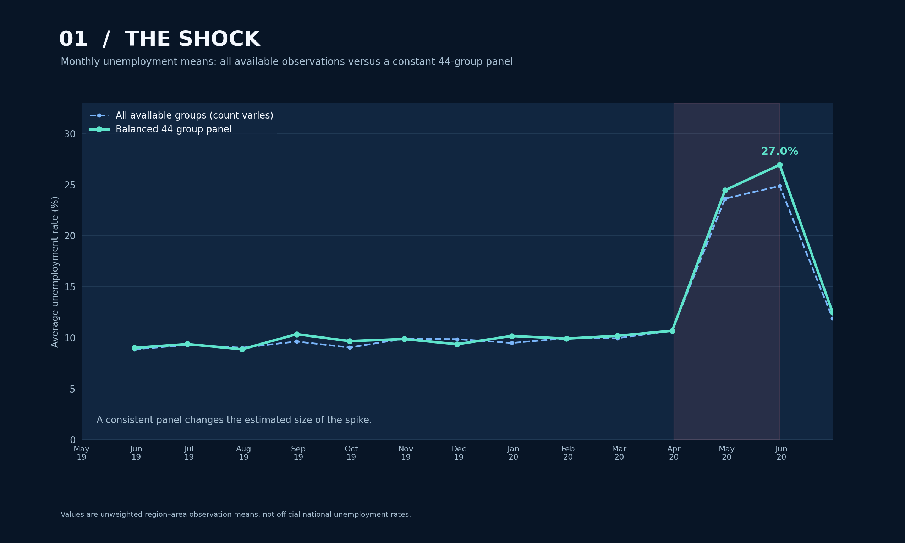
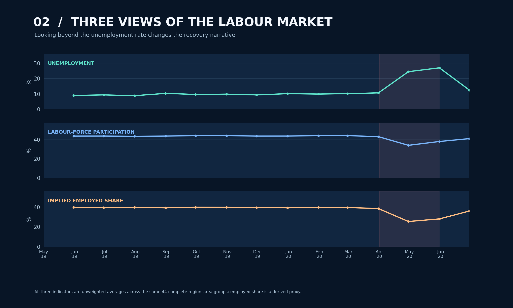
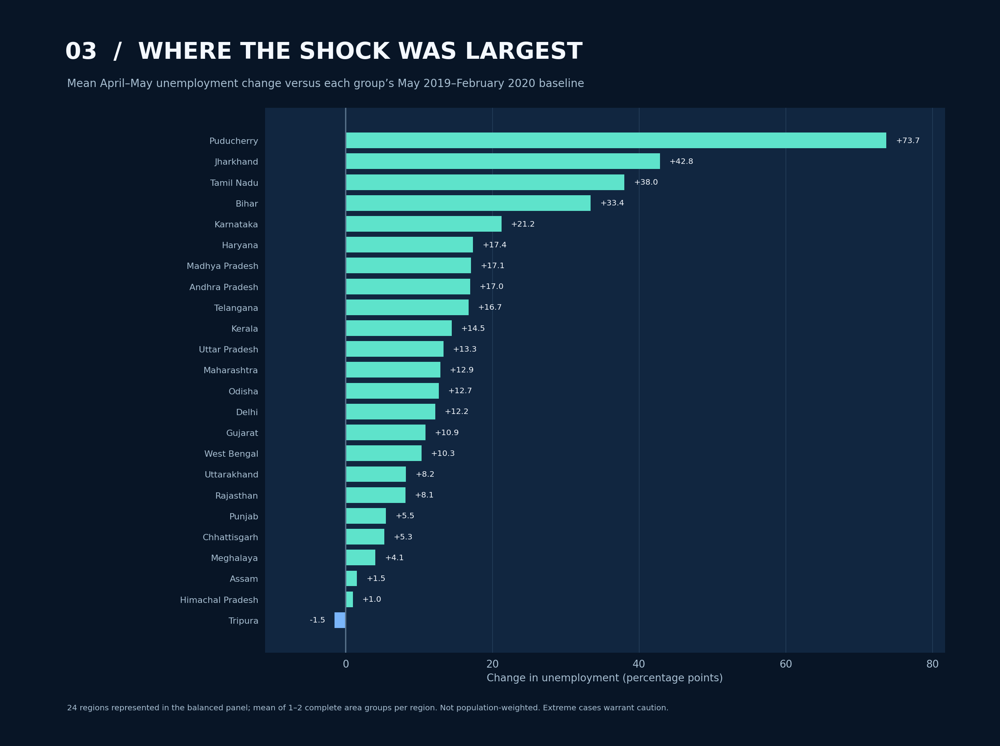
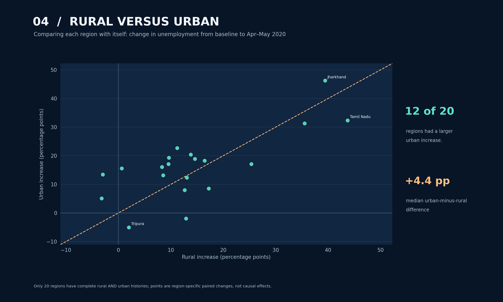
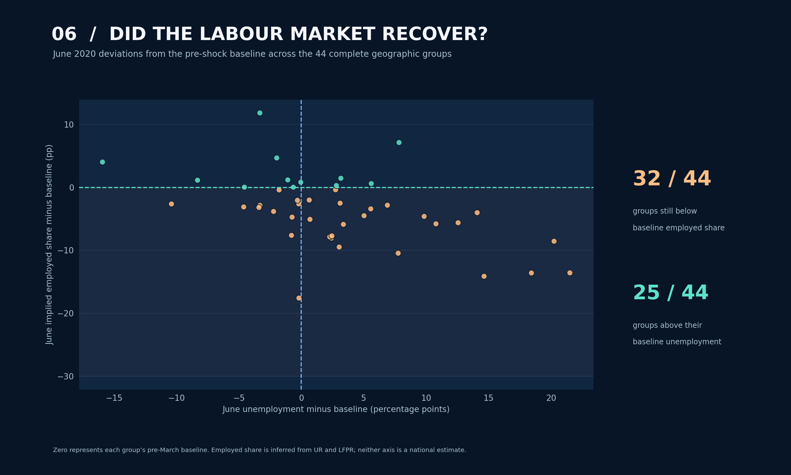

# Beyond the Unemployment Rate
### India's 2020 Labour-Market Shock | A regional and rural–urban data investigation

**Python · Pandas · Matplotlib · Descriptive panel analysis · Data quality · Statistical reasoning**



> **Main finding:** In the **44 consistently observed geographic groups**, mean unemployment increased by **16.03 percentage points** from the May 2019–February 2020 baseline to April–May 2020. Although unemployment declined by June, the *implied employed share* remained below baseline in **32 of those 44 groups**.
>
> These are descriptive results for a **balanced set of region–area observations**, not official national unemployment or employment-to-population estimates.

## The question

India's April–May 2020 employment disruption is visible in unemployment-rate plots. But how consistent was the disruption across places and rural–urban areas? How much do incomplete monthly observations affect the results? And does the falling unemployment rate in June establish that employment conditions recovered?

This project investigates those questions with a deliberately narrow, **single-dataset** design. It does **not** train a forecasting model, infer that government policy caused the observed changes or extend beyond June 2020.

## Results at a glance

| Measure | Earlier baseline | April–May 2020 | June 2020 |
|---|---:|---:|---:|
| Average unemployment rate | 9.69% | 25.71% | 12.50% |
| Average labour-force participation | 44.06% | 36.23% | 41.23% |
| Average **implied employed share** | 39.62% | 26.78% | 36.05% |

**How these numbers were calculated:** Each of 44 complete region–rural/urban groups contributes once to each period's average. The baseline is **May 2019–February 2020**, the disruption window is **April–May 2020**, and June is a single month. Values are **unweighted geographic-group means**. The implied employed share is calculated **within each observation** as `participation_rate × (1 − unemployment_rate/100)`, assuming compatible indicator denominators.

### What the investigation found

1. **Widespread observed deterioration.** Unemployment increased in **40 of 44** complete groups. The mean increase was **16.03 percentage points**, with a median geographic-group change of **13.31 points**.
2. **Initial reversal was incomplete in the wider indicator picture.** By June, the average implied employed share was **3.58 points below baseline**, and **32 of 44** complete groups remained below their earlier own baseline on that derived indicator.
3. **Extreme cases are disclosed rather than deleted.** The largest full-panel group change was **Puducherry | Urban (+73.72 pp)**. Excluding that one group for a sensitivity check leaves a mean shock of **+14.69 pp**, compared with **+16.03 pp** in the full panel.
4. **Rural–urban changes are not uniform.** Among **20 regions** with complete rural and urban histories, **12** had a larger urban unemployment-rate increase; **8** did not. The median urban-minus-rural difference was **+4.44 percentage points**.
5. **Changing group coverage matters.** The original CSV contains 740 observations, 55 observed region–area groups and 14 months. **30 observed-group/month combinations are absent**, and only **44 groups** have all 14 months. In May 2020, the all-available mean was **24.88%**, while the complete-panel mean was **26.96%**. Neither should be called an official national rate.
6. **Absolute employed counts can mislead across regions.** The older notebook compared employed counts with a regional ANOVA and rural/urban t-test; the rebuild focuses instead on **within-group rate changes** and carefully framed descriptive comparisons.

## Visual evidence

**Observed shock and sample sensitivity**



**Unemployment, labour participation and derived employment share**



**Different regional trajectories**



**A more meaningful rural/urban comparison**



**June's recovery paradox**



Also available: [complete coverage matrix](assets/05_coverage_matrix.png) and [sample-composition sensitivity chart](assets/07_composition_sensitivity.png).

## What makes the analysis defensible?

- The original CSV is **preserved byte-for-byte**, and its SHA-256 is recorded in the methodology.
- No missing geographic months are silently imputed.
- A constant 44-group panel underpins the main before/after comparisons; the all-available sample is shown for contrast.
- All reported changes use **percentage points** where appropriate.
- The employed-share proxy is derived row-by-row, not from independently averaged indicators.
- The analysis includes regional matching, median/interquartile dispersion and a region-cluster resampling *sensitivity* exercise. That interval is **not** treated as a national survey confidence interval.
- The single-month June observation is described as an **initial reversal**, not a complete economic recovery.
- Data limitations and scope boundaries are documented in [METHODOLOGY.md](reports/METHODOLOGY.md).

## Explore and reproduce

**Start with the full [executed notebook](unemployment_analysis.ipynb)**. It walks through data checks, definitions, research questions, figures, interpretations and limitations. The notebook contains saved outputs and can be inspected directly on GitHub.

### Requirements

Python 3.11+ recommended, with `pandas`, `numpy`, `matplotlib`, `jupyter`, `nbclient`, `nbformat`, `IPython` and `pytest`.

```bash
python -m pip install -r requirements.txt
jupyter lab unemployment_analysis.ipynb
```

Open the notebook and select **Restart & Run All**. Run it from inside this project folder so its relative CSV and `src/` imports resolve. Generated figures and tables will be written to `assets/` and `reports/`. To run validation checks:

```bash
python -m pytest tests -q
```

No external API, private account or supplementary dataset is required. The source dataset is local.

### Files

| Path | Purpose |
|---|---|
| `unemployment_analysis.ipynb` | Fully executed narrative investigation |
| `unemployment_india.csv` | Unmodified source snapshot |
| `src/analysis.py` | Data contracts and reproducible comparisons |
| `src/visuals.py` | Consistent figure-generation functions |
| `assets/*.png` | Eight publication-quality project figures |
| `reports/METHODOLOGY.md` | Definitions, analytical reasoning and limitations |
| `reports/reproduced_metrics.json` | Auditable headline metrics from execution |
| `reports/monthly_*.csv`, `reports/matched_group_comparisons.csv` | Derived descriptive tables |
| `tests/` | Automated analytical validation |

## Data credit and interpretation boundaries

**Dataset:** [Unemployment in India, Kaggle](https://www.kaggle.com/datasets/gokulrajkmv/unemployment-in-india), using the existing local CSV snapshot. Kaggle is the hosting location identified for this project; the hosting page alone does not establish the original statistical producer, microdata sampling design or complete rights information. This analysis does not use any second dataset.

**Not claimed:** official national unemployment levels, nationally representative confidence intervals, causal lockdown impacts, individual job losses, motivations for changes in participation, or recovery after June 2020.

**Author:** Sonkhe Shongwe. Reconstructed as an evidence-first data analytics portfolio case study.
